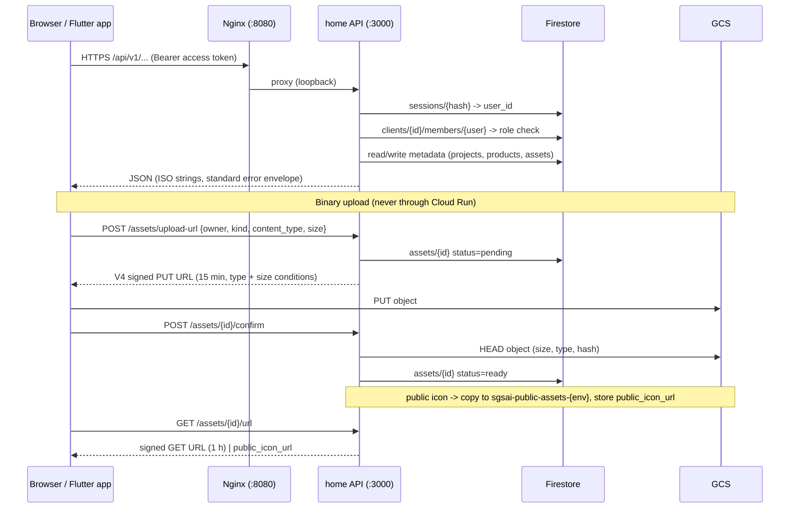

# ADR-002: Firestore-first data platform; `home` owns `/api/v1` for the client hub

- Status: **Accepted** 2026-10-27 (founder decision; founder is the approver and administrator)
- Tracking issue: [home#55](https://github.com/sgsai-lab/home/issues/55)
- Supersedes for the hub: `backend-api` ADR-001 ([backend-api#7](https://github.com/sgsai-lab/backend-api/issues/7)) auth ownership
- Related: [plan](../product/oneai-client-platform-plan.md), [infrastructure#14](https://github.com/sgsai-lab/infrastructure/issues/14), [backend-api#23](https://github.com/sgsai-lab/backend-api/issues/23), [mobile-app#21](https://github.com/sgsai-lab/mobile-app/issues/21)

## Context

Three repositories implied three answers to "where does product data live and who serves `/api/v1`": `home` (Node, Firestore), `backend-api` (FastAPI, Postgres, backend-owned auth), `infrastructure` (Cloud SQL). The web account UI was coded against the `backend-api` contract that `home` never implemented, which is why sign-up, login, password reset, MFA, admin users and projects return `404` in production. The founder's direction is Firestore now, Postgres possibly later, binaries in GCS, one hub for business and education clients, and a mobile launcher.

## Decisions

| # | Question | Decision |
| --- | --- | --- |
| 1 | Who signs in to the hub | **Client staff only.** Students and a client's customers use the client's own PWA; they never get hub accounts. No minors' data in the hub. |
| 2 | Where sector lives | **Per project** (`projects.sector`). A client carries `primary_sector` for display and defaults only. |
| 3 | Mobile authentication | **`home` tokens.** The Flutter app uses the same `/api/v1/auth/*` endpoints as the web. Google Sign-In on device yields an ID token that `home` verifies (web, Android and iOS audiences). **Sign in with Apple is offered on iOS and Android**; Android uses Apple's web flow, so `home` exposes `POST /api/v1/auth/apple/callback` to relay the `form_post` back into the app. No Firebase Auth SDK for identity. |
| 4 | Backend ownership | **`home`'s Node API is the system of record for `/api/v1` for the next six weeks.** `backend-api` pauses feature work on auth, users, projects and products and keeps health, CI and deploy. Cloud SQL ([infrastructure#8](https://github.com/sgsai-lab/infrastructure/issues/8)) is paused. |
| 5 | Database | **Firestore, native mode, same GCP project as Cloud Run**, accessed only from the API with `@google-cloud/firestore`. Firestore Rules deny all client-SDK access. TTLs, indexes and backups in Terraform. |
| 6 | Media | **Private bucket per environment + V4 signed URLs for everything. Public product icons are copied to a small public bucket** so the marketing page needs no API call for images. |
| 7 | Launch links | **`/go/{slug}` for `visibility=client` products requires sign-in**; anonymous visitors are redirected to `/login/?next=`. Mobile passes a 60-second single-use launch token. Public products redirect immediately. |
| 8 | Mobile dates | **Internal build in Week 7 (Dec 2026); private beta Q1 2027** (as published on `/products/`). |
| 9 | Approval | **Founder approves and administers**; repository owners are informed through the linked issues. |

## Stack (final)

| Layer | Choice | Notes |
| --- | --- | --- |
| Web | Framework-free HTML/CSS/ES modules in `public/`, built by `scripts/build.mjs` | Installable PWA for `/workspace/` ([home#69](https://github.com/sgsai-lab/home/issues/69)) |
| Edge | Nginx in the same container, strict CSP, proxies `/api/*`, `/go/*`, `/.well-known/*` | New non-`/api/v1` paths need a `location` block |
| API | Node 22, `src/server/server.mjs`, no framework | Single `createRequestHandler`; route modules under `src/server/routes/` as it grows |
| Identity | `home` issues opaque access tokens (sessionStorage on web, Keychain/Keystore on mobile) and single-use rotating refresh tokens (HttpOnly cookie for `X-Client: web`, JSON body for `X-Client: mobile`) | Google and Apple ID tokens verified server-side; email + password with scrypt; TOTP MFA |
| Metadata store | Firestore native mode | Collections below; the API is the only reader/writer |
| Binary store | GCS `sgsai-media-{env}` (private) and `sgsai-public-assets-{env}` (public icons) | Signed URLs issued by the API using the runtime service account (`signBlob`) |
| Mobile | Flutter (`mobile-app`), Riverpod, go_router, Dio | Firebase SDKs only for Cloud Messaging, Crashlytics, App Distribution, Remote Config, Analytics |
| Infra | Terraform in `infrastructure` | Firestore, buckets, IAM, budgets, alerts |
| Deferred | FastAPI + Postgres (`backend-api`) | Keeps the identical URL contract and error envelope so `API_UPSTREAM` can be repointed later |

## Data model

Metadata only. Every tenant-owned document carries `client_id`.

```text
users/{userId}                      email, full_name, avatar_url, role: user|admin, email_verified, password_hash?,
                                    google_sub?, apple_sub?, mfa{enabled, secret_enc, recovery_hashes[]}, status,
                                    default_client_id, created_at, updated_at
clients/{clientId}                  name, slug, primary_sector: business|education, status: prospect|active|paused|closed,
                                    branding{logo_asset_id, primary_color}, contact{email, phone, website},
                                    created_by, created_at, updated_at
clients/{clientId}/members/{userId} user_id, client_id, role: owner|admin|member|viewer, status: invited|active|removed,
                                    invited_by, joined_at                       (collection group "members")
invites/{inviteId}                  client_id, email, role, token_hash, expire_at (TTL 7 d), accepted_at
projects/{projectId}                client_id, name, slug, sector: business|education, status, summary,
                                    start_date, end_date, tags[], owner_user_id, cover_asset_id,
                                    sector_profile{...}, milestones[], deleted_at, created_at, updated_at
products/{productId}                client_id, project_id?, kind: pwa|web|android|ios|service, name, slug,
                                    summary, launch_url, store_urls{}, icon_asset_id, public_icon_url?,
                                    status: planned|beta|live|retired, visibility: client|public, order
assets/{assetId}                    owner{type, id}, client_id, kind, gcs_bucket, gcs_object, content_type,
                                    size_bytes, sha256, status: pending|ready|deleted, pending_expire_at (TTL 1 d)
launch_tokens/{tokenHash}           product_id, user_id, expire_at (TTL 60 s), used_at
launch_events/{eventId}             product_id, client_id, user_id?, source: web|android|ios|link, expire_at (TTL 180 d)
audit_log/{eventId}                 actor_id, action, target{type,id}, client_id?, request_id, expire_at (TTL 90 d)
sessions/{tokenHash}, refresh_tokens/{tokenHash}, password_resets/{tokenHash}, email_verifications/{tokenHash}
                                    user_id, client: web|android|ios, user_agent, expire_at (TTL)
```

Authorisation: `requireMembership(userId, clientId, minRole)` with `viewer < member < admin < owner`; global `role=admin` bypasses tenancy. Only `admin` may list across clients.

## Flows

### Request path and storage



### Authentication

```mermaid
sequenceDiagram
  participant W as Web (X-Client: web)
  participant M as Mobile (X-Client: mobile)
  participant A as home API
  participant F as Firestore

  W->>A: POST /auth/login | /auth/google | /auth/apple
  A->>F: verify user, write sessions + refresh_tokens
  A-->>W: {access_token, expires_in} + Set-Cookie __Host-refresh (HttpOnly)
  M->>A: POST /auth/google {id_token (Android/iOS audience)}
  A->>F: same
  A-->>M: {access_token, expires_in, refresh_token}
  M->>A: POST /auth/token/refresh {refresh_token}
  A->>F: consume (single use) + rotate; reuse -> revoke family
  A-->>M: new pair
```

### Launch link

```mermaid
flowchart LR
  L[/go/slug] --> R{product found?}
  R -- no --> NF[404 branded page]
  R -- yes --> V{visibility}
  V -- public --> E[write launch_event] --> X[302 launch_url + utm]
  V -- client --> S{session cookie or ?t= launch token}
  S -- none --> LG[302 /login/?next=/go/slug]
  S -- valid + member --> E
  S -- valid, not member --> F403[403 ask your admin]
```

## Consequences

- `home` implements the full `/api/v1` contract ([home#45](https://github.com/sgsai-lab/home/issues/45), [#47](https://github.com/sgsai-lab/home/issues/47), [#48](https://github.com/sgsai-lab/home/issues/48), [#58](https://github.com/sgsai-lab/home/issues/58), [#62](https://github.com/sgsai-lab/home/issues/62), [#63](https://github.com/sgsai-lab/home/issues/63), [#67](https://github.com/sgsai-lab/home/issues/67)). Mobile support adds `X-Client: mobile` JSON refresh delivery and multi-audience Google verification (`GOOGLE_CLIENT_IDS`).
- `mobile-app`: APP-07 becomes "sign in against the SGS API"; APP-04 drops Authentication from the Firebase services list; app config points at `https://www.sgsaitechnology.com/api/v1` (dev flavour at the dev Cloud Run URL).
- `backend-api`: API-07…API-16 are paused; the repo keeps CI/deploy green and tracks the migration spike ([backend-api#24](https://github.com/sgsai-lab/backend-api/issues/24)). When Postgres is revisited, `backend-api` must reproduce this contract byte-for-byte before `API_UPSTREAM` is switched.
- `infrastructure`: Cloud SQL paused; Firestore and GCS managed in Terraform ([infrastructure#12](https://github.com/sgsai-lab/infrastructure/issues/12), [#13](https://github.com/sgsai-lab/infrastructure/issues/13)).
- Hidden costs accepted: Firestore has no full-text search (prefix matching only); public icon copies must be removed when visibility changes; the in-memory DB fallback is disabled in production ([home#53](https://github.com/sgsai-lab/home/issues/53)).

## Alternatives considered

- **Postgres now via `backend-api`**: more relational power, but a second runtime and database before the first client is onboarded; rejected for the next six weeks.
- **Firebase Identity Platform / Firebase Auth SDK on mobile**: less code, but two identity systems and weaker control over sessions, MFA UX and revocation; rejected.
- **Firestore client SDK with Security Rules**: lets the apps talk to Firestore directly; rejected so authorisation lives in one place (the API) and the Postgres exit stays possible.
- **Single private bucket for icons too**: simplest, but the marketing page would depend on the API for images; rejected in favour of a tiny public bucket.

## Exit path to Postgres

`src/server/db.mjs` (and `routes/*`) are the only data access layer; fields are snake_case ISO strings; no Firestore types leak into responses. The migration spike ([backend-api#24](https://github.com/sgsai-lab/backend-api/issues/24)) proves export → import → identical JSON. Cut-over is an `API_UPSTREAM` change in Nginx with rollback by reverting it.
