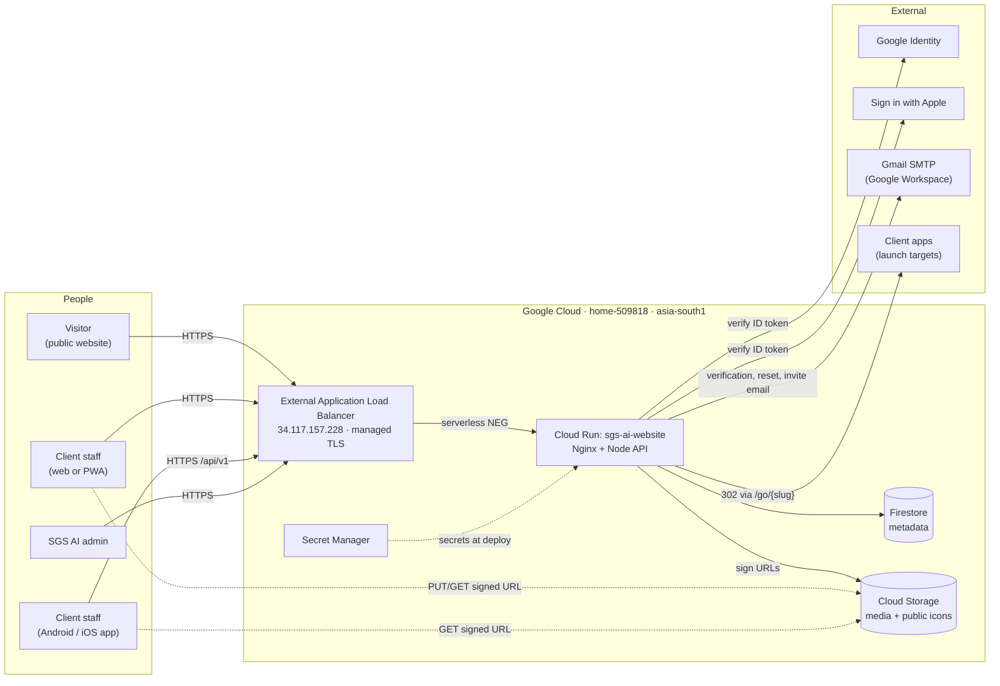
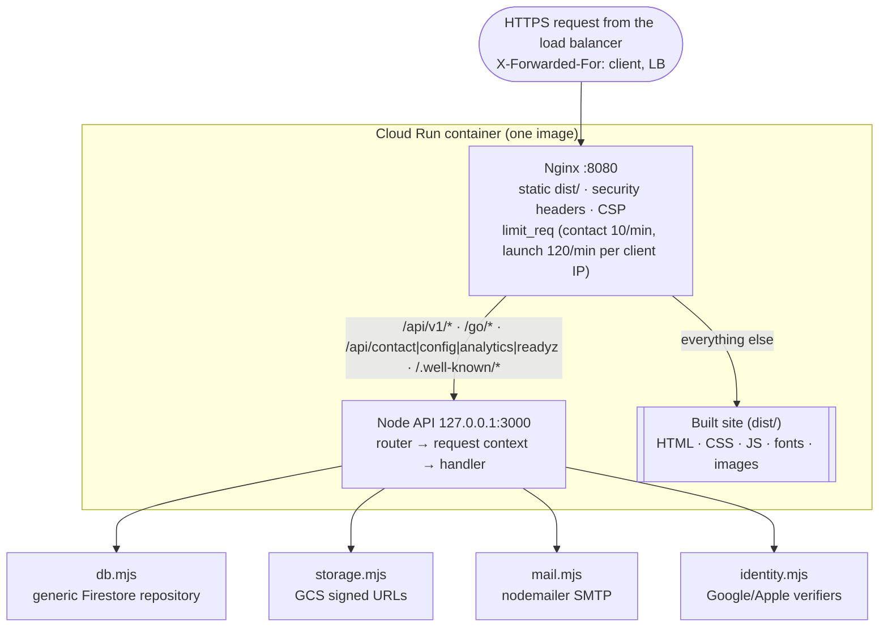
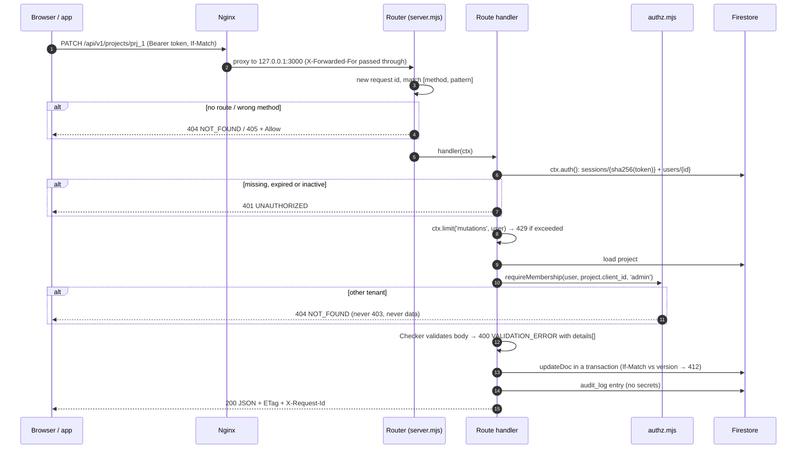
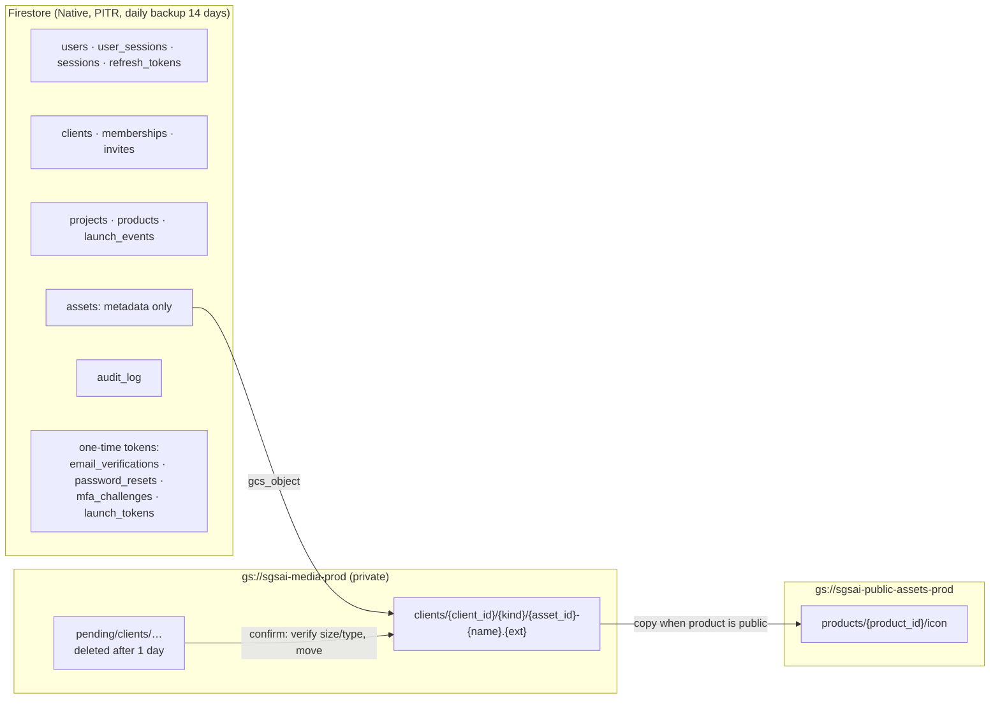

# 1. Architecture

## In one paragraph

`sgsaitechnology.com` and `www.sgsaitechnology.com` resolve to a **global external Application Load Balancer** (managed TLS certificates, HTTP → HTTPS redirect) whose serverless backend is one Cloud Run service in project `home-509818` (region `asia-south1`). Each container runs **Nginx** on port 8080 and a **Node.js 22 API** on loopback port 3000. Nginx serves the static website and the client hub pages, applies the security headers and coarse rate limits, and proxies API and launch-link paths to Node. The API is the only component that reads or writes data: **Firestore** holds metadata (users, workspaces, projects, apps, file records, audit log) and **Cloud Storage** holds the files themselves. Browsers and the mobile app upload and download files **directly** to Cloud Storage with short-lived signed URLs, so file bytes never pass through Cloud Run. Identity comes from email + password (with optional TOTP), Google, or Apple; email is sent through Google Workspace SMTP. Infrastructure is Terraform in the `infrastructure` repo, and both repos deploy through GitHub Actions using Workload Identity Federation (no keys).


Source: [architecture.drawio](architecture.drawio).

## System context



## Inside the container



| Layer | Code | Responsibility |
| --- | --- | --- |
| Load balancer | `infra/gcp/terraform` | Global external Application Load Balancer: managed certificates for both domains, HTTP → HTTPS redirect, serverless NEG to Cloud Run |
| Edge | [config/nginx.conf](../../config/nginx.conf) | Sets CSP, `X-Frame-Options`, `nosniff`, `Referrer-Policy`; caches static files; proxies API paths; rate-limits the contact form and launch links per client (key selection is wrong behind the load balancer: #81) |
| Dispatcher | [src/server/server.mjs](../../src/server/server.mjs) | Legacy endpoints, readiness, app-link files; builds a per-request context (`ctx.auth`, `ctx.admin`, `ctx.limit`, `ctx.audit`, `ctx.body`, request id) and renders one error envelope |
| Routes | [src/server/routes/](../../src/server/routes/) | `auth`, `users`, `clients`, `projects`, `products` (+ `/go`), `assets`, `audit` |
| Policy | [authz.mjs](../../src/server/authz.mjs), [validation.mjs](../../src/server/validation.mjs) | Workspace roles and tenant isolation; input validation that reports every field problem at once |
| Data | [db.mjs](../../src/server/db.mjs) | `getDoc`, `setDoc`, `updateDoc` (transaction), `queryDocs`, `deleteWhere`, token helpers; in-memory implementation for tests |
| Files | [storage.mjs](../../src/server/storage.mjs) | V4 signed upload/read URLs (signed through IAM `signBlob`, no key files), promote, publish public icons |
| Crypto | [security.mjs](../../src/server/security.mjs) | scrypt passwords, TOTP, AES-256-GCM for MFA secrets, HMAC-signed state |

## How one API request is handled



Every `/api/v1` error has the same shape, so web and mobile handle errors in one place:

```json
{ "error": { "code": "VALIDATION_ERROR", "message": "Check the highlighted fields.", "details": [{ "field": "name", "message": "This field is required." }], "request_id": "…" } }
```

`DatabaseUnavailableError` becomes `503 SERVICE_UNAVAILABLE` with `Retry-After`; any unexpected error becomes `500 INTERNAL` and is logged with the request id and stack (never the body).

## Data storage flow

The founder's rule: **Firestore stores metadata; Cloud Storage stores the original files.**



| Kind of data | Where | Why |
| --- | --- | --- |
| Accounts, sessions, tokens | Firestore, tokens stored only as SHA-256 | A database leak yields no usable credentials |
| Workspaces, projects, apps | Firestore, every document carries `client_id` | Tenant isolation is a single equality filter |
| Files (images ≤ 10 MB, video ≤ 500 MB, documents ≤ 25 MB) | Private bucket, read through 1-hour signed URLs | Cloud Run never streams large files; access is checked per request |
| Icons of public apps | Public assets bucket | The public `/products/` page can show them without signing |
| Short-lived records | Firestore with an `expire_at` TTL field | Firestore deletes them automatically (24 h, 1 h, 5 min, 60 s, 7 days, 30/90/180 days) |

Details: [data model](../data-model.md) and [media storage](06-media-storage.md).

## Scale and limits

- Cloud Run: `--min 0 --max 5`, 256 MiB. Cold starts are acceptable for current traffic.
- Application rate limits are kept **in memory per instance** (at most 5 instances), which is enough to stop brute force without a shared store. Nginx adds per-client-IP limits for the contact form and launch links.
- Lists load at most a few thousand documents for one workspace and sort/page in the API. This is deliberate for tens of workspaces and hundreds of projects; [ADR-003](11-postgres-migration-path.md) is the path when that stops being true.

## Security layers

| Threat | Control |
| --- | --- |
| XSS, clickjacking | Strict CSP (`'self'` plus Google/Apple sign-in and `storage.googleapis.com`), no inline script/style (lint enforced), `frame-ancestors 'none'`, DOM built with `textContent` |
| Credential theft | scrypt (N=2¹⁵), refresh tokens single-use with family revocation, HttpOnly SameSite=Strict refresh cookie, optional TOTP |
| Account takeover by pre-registration | Provider sign-in discards credentials of an unverified account with the same email |
| Cross-tenant access | `requireMembership` on every tenant resource; other tenants get `404` |
| Brute force | Per-IP, per-email, per-user and MFA limits; 5 wrong TOTP codes lock 2FA for 15 minutes (also during re-authentication) |
| Unsafe uploads | Type allow-list (no SVG/HTML), exact size in the signed URL, verified on confirm |
| Secrets | Secret Manager, mounted at deploy; never in `/api/config`, logs or audit diffs |
