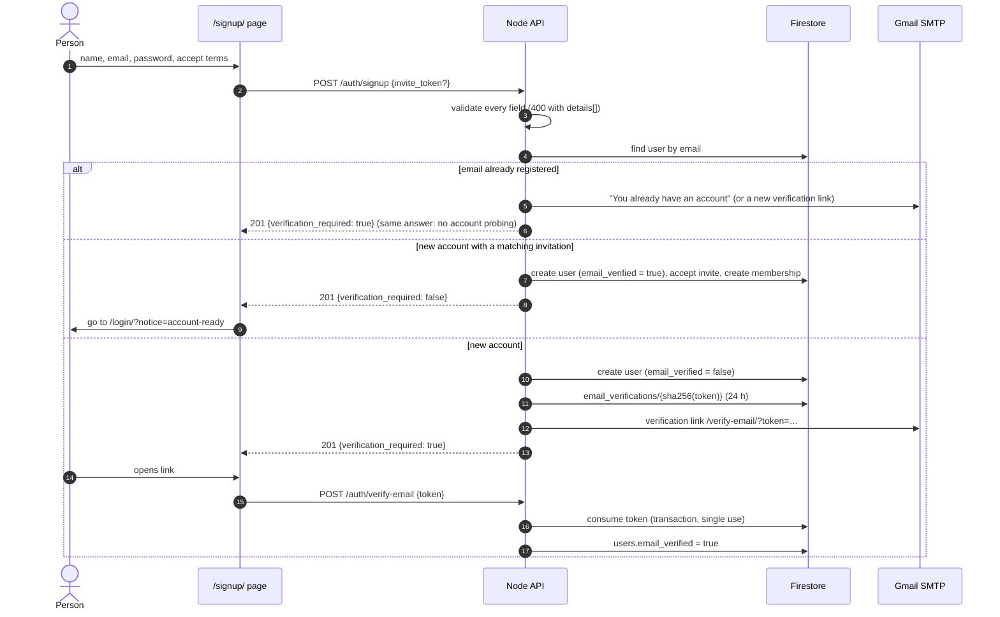
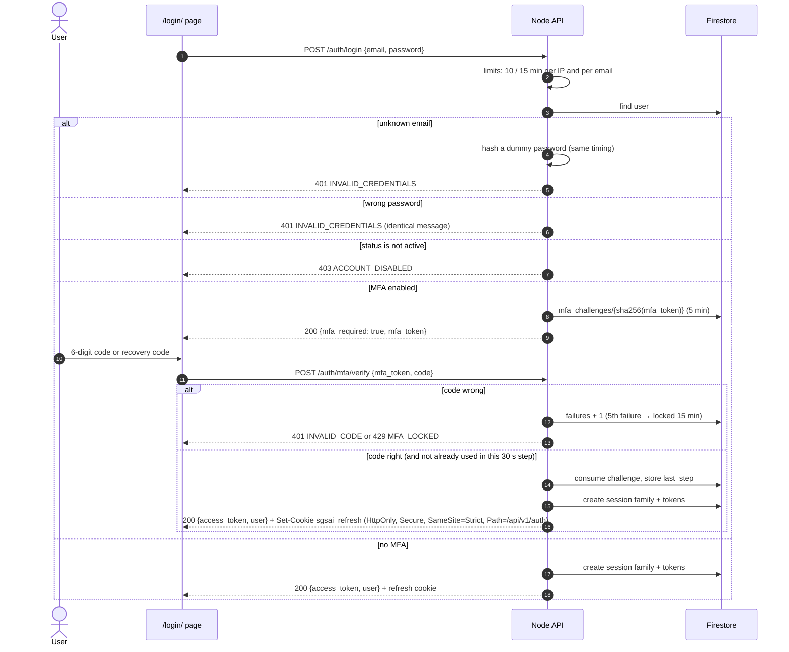
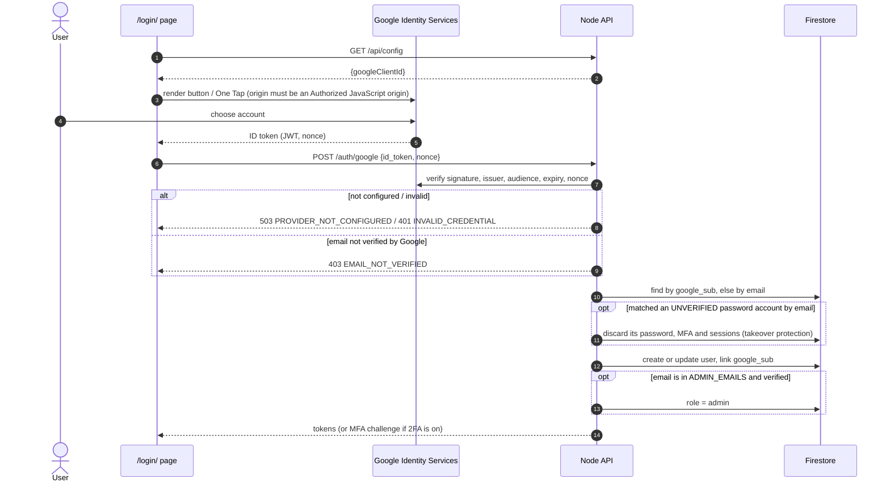
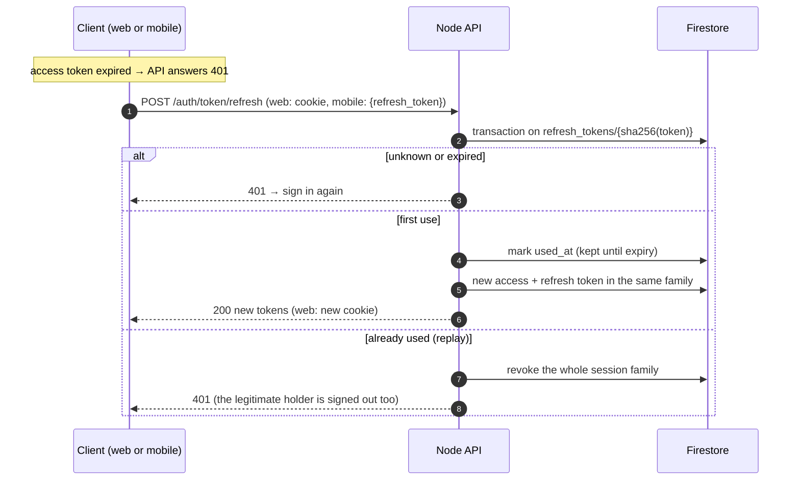
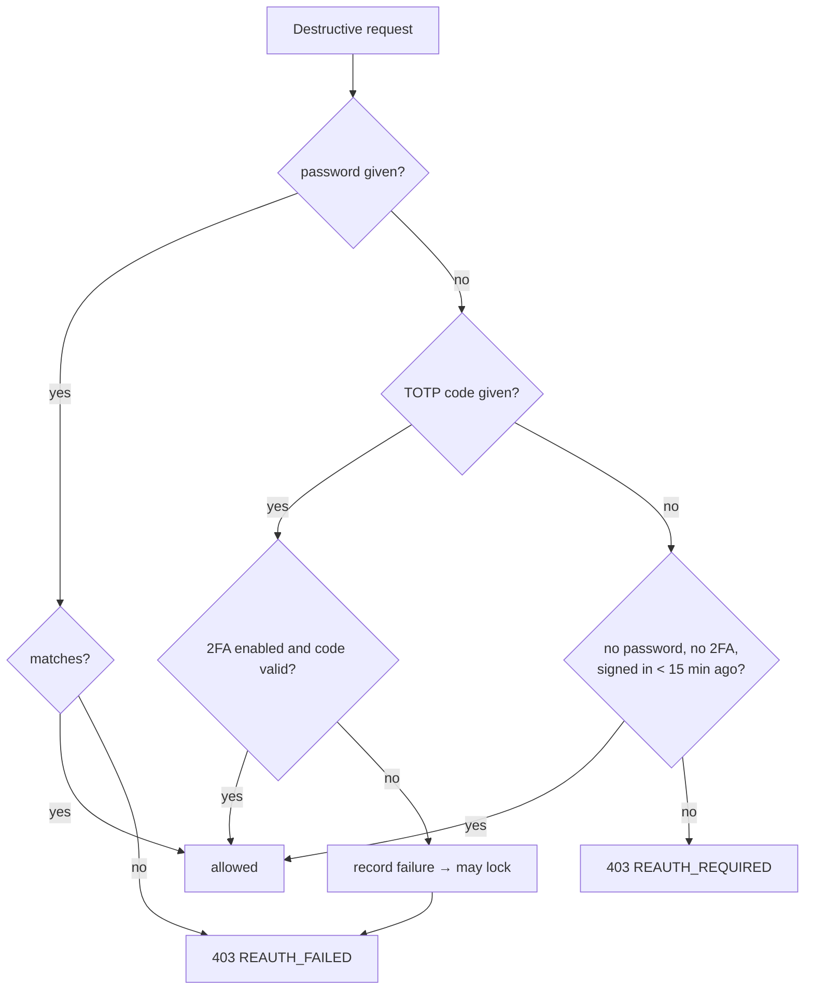
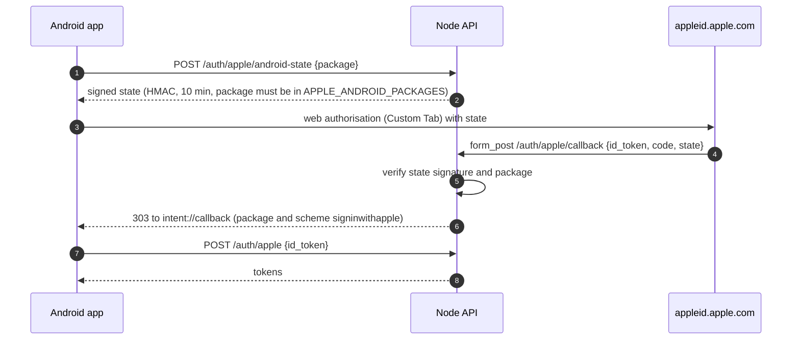
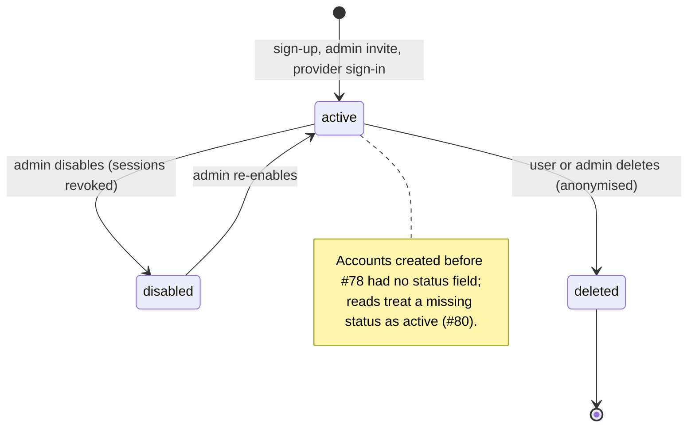

# 3. Identity and sessions

Code: [routes/auth.mjs](../../src/server/routes/auth.mjs), [db.mjs](../../src/server/db.mjs) (sessions), [security.mjs](../../src/server/security.mjs), [identity.mjs](../../src/server/identity.mjs). Browser: [auth.js](../../public/assets/js/auth.js), [auth-providers.js](../../public/assets/js/auth-providers.js). Mobile: [08-mobile-app.md](08-mobile-app.md).

## Sign-in methods

| Method | Proof of email | Notes |
| --- | --- | --- |
| Email + password | Verification link (24 h) or an accepted invitation | scrypt hash; 10–128 characters |
| Google (web: Google Identity Services; mobile: native SDK) | Google's `email_verified` must be true | Audiences: `GOOGLE_CLIENT_ID` + `GOOGLE_CLIENT_IDS` (web, Android, iOS client ids) |
| Apple (web and iOS; Android through a relay) | Apple sends the email only on first authorisation | Audiences: `APPLE_CLIENT_ID` + `APPLE_CLIENT_IDS`; currently not configured |
| TOTP second factor (optional) | — | RFC 6238, 6 digits, 30 s, ±1 step, each step accepted once; 10 single-use recovery codes |

## Lifetimes

| Item | Lifetime | Storage |
| --- | --- | --- |
| Access token | 1 hour | `sessions/{sha256}` |
| Refresh token | 30 days, single use | `refresh_tokens/{sha256}` (kept after use to detect reuse) |
| Session family ("device") | 90 days absolute | `user_sessions/{ses_…}` |
| Email verification link | 24 hours | `email_verifications/{sha256}` |
| Password reset link | 1 hour | `password_resets/{sha256}` |
| MFA challenge after password/Google | 5 minutes | `mfa_challenges/{sha256}` |
| MFA lockout | 15 minutes after 5 wrong codes | on the user document |
| "Recent sign-in" for re-authentication without a password | 15 minutes | session family `created_at` |

Every expiring record also gets an `expire_at` timestamp, so Firestore's TTL policy deletes it.

## Email sign-up and verification

Sign-in with an unverified address answers `403 EMAIL_NOT_VERIFIED`; the login page then requests a new link automatically.

## Password sign-in with a second factor

## Google sign-in (web)

Account linking (`POST /auth/google/link`) attaches Google to an existing signed-in account and refuses a Google account already linked elsewhere (`409`). Unlinking is refused if Google is the only sign-in method (`409 LAST_SIGN_IN_METHOD`).

## Refresh rotation and theft detection

Web clients never see the refresh token. Mobile clients send `X-Client: mobile` and `X-Client-Platform: android|ios`, receive `refresh_token` in JSON, store it in the keystore/keychain, and refresh one request at a time.

## Sessions page, sign-out and password changes

| Action | Effect |
| --- | --- |
| `GET /auth/sessions` | One row per family: device (Browser / Android app / iOS app), user agent, started, last used |
| `DELETE /auth/sessions/{id}` | Revokes that family's access and refresh tokens immediately |
| `POST /auth/logout` | Revokes the current family and clears the cookie |
| `POST /auth/logout-all` | Revokes every family |
| Password change | Keeps this session, revokes the others |
| Password reset | Revokes all sessions; requires a TOTP or recovery code if 2FA is on; also marks the email verified |
| Admin disables an account | Revokes all sessions; sign-in answers `ACCOUNT_DISABLED` |

## Re-authentication for destructive actions

Disabling 2FA and deleting the account require one of: the password, a current TOTP code, or (for Google/Apple-only accounts without 2FA) a sign-in within the last 15 minutes. Wrong codes count towards the same 5-attempt lockout as sign-in (fixed after the Copilot review of #78).

Account deletion anonymises the user (email `deleted+{id}@invalid`, name "Deleted user"), removes memberships and sessions, and keeps the id so audit history stays consistent. The last owner of a workspace must transfer ownership first.

## Sign in with Apple on Android

Apple has no native Android SDK, so the app uses Apple's web flow and the API relays the result back into the app.

## Account status

