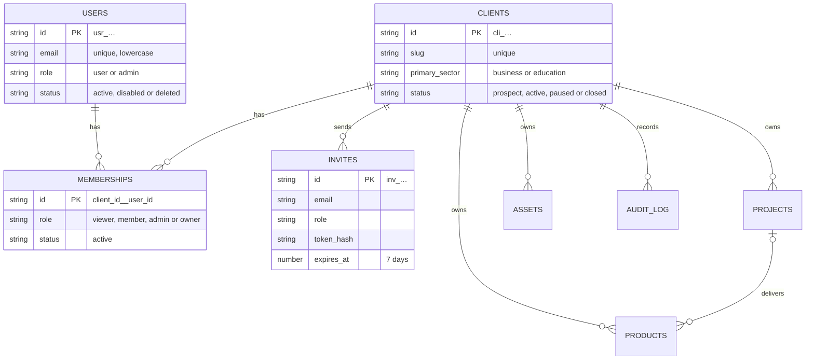
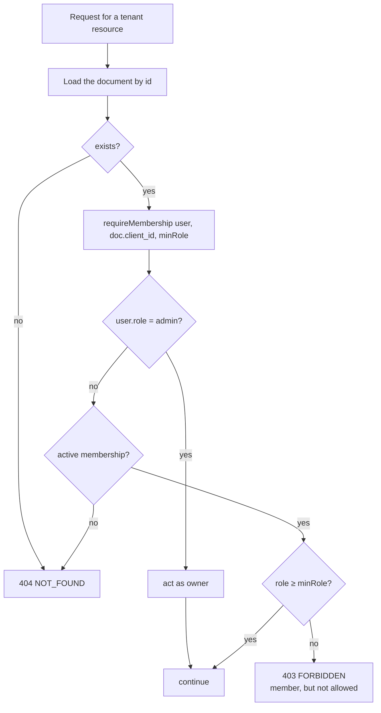
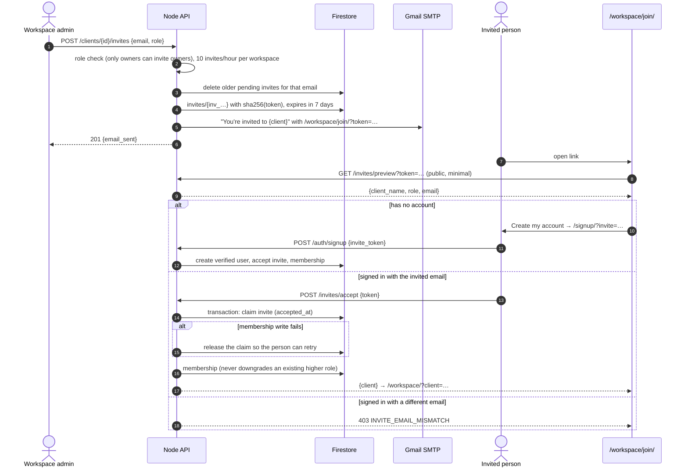
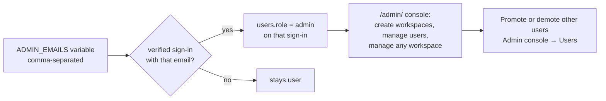

# 4. Workspaces and access

Code: [routes/clients.mjs](../../src/server/routes/clients.mjs), [authz.mjs](../../src/server/authz.mjs), [routes/users.mjs](../../src/server/routes/users.mjs), [routes/audit.mjs](../../src/server/routes/audit.mjs). Pages: `/admin/` (SGS console), `/admin/clients/?id=` (workspace console), `/workspace/join/`.

## Model

Memberships are a **top-level** collection with a deterministic id, so "my workspaces" is one equality query and "is this user a member?" is one document read.

## Who can do what

| Action | Viewer | Member | Admin | Owner | SGS admin |
| --- | :-: | :-: | :-: | :-: | :-: |
| See workspace, projects, apps, team, files | ✓ | ✓ | ✓ | ✓ | ✓ |
| Open apps (launch token) | ✓ | ✓ | ✓ | ✓ | ✓ |
| Edit workspace details, logo | | | ✓ | ✓ | ✓ |
| Change workspace status | | | | | ✓ |
| Create/edit/delete projects, upload files | | | ✓ | ✓ | ✓ |
| Create/edit apps | | | ✓ | ✓ | ✓ |
| Make an app public on sgsaitechnology.com | | | | | ✓ |
| Invite people, change roles (except owners) | | | ✓ | ✓ | ✓ |
| Make or change owners | | | | ✓ | ✓ |
| Add an existing account directly | | | | | ✓ |
| View the workspace activity log | | | | ✓ | ✓ |
| Create workspaces, manage all users | | | | | ✓ |
| Leave a workspace | ✓ | ✓ | ✓ | ✓ (not the last) | — |

## Tenant isolation

Every tenant document carries `client_id`. Handlers never trust a `client_id` from the request for authorisation; they load the document and check its own `client_id`.

Non-members always get `404`, so an outsider cannot tell whether a workspace, project or file exists. Members with too low a role get `403` with a message naming the role they need. Lists are scoped by the caller's memberships (`client_id in [...]`, chunked by 30).

## Invitation flow

A used invitation answers `410 INVITE_CONSUMED`; an unknown or expired one `404 INVITE_INVALID`. Resending issues a new token, so the old link stops working.

## SGS administrators

- Bootstrap: the first admin comes from `ADMIN_EMAILS` (currently `huggi.vittal@sgsaitechnology.com`). Later admins can be promoted in the console.
- Admins cannot change their own role or status (`400 SELF_MODIFICATION`), so the last admin cannot lock themselves out.
- Creating a user from the console emails a set-password link valid for 24 hours.

## Workspace console (`/admin/clients/?id=`)

| Tab | What it does |
| --- | --- |
| Overview | Name, sector, contact, brand colour, status (SGS only), logo upload |
| People | Invite, resend, revoke; change roles; remove or leave |
| Apps | Add/edit apps, copy the `/go/` link, launch counts (30 days), icon upload, public visibility (SGS only) |
| Activity | Audit log for owners: who did what in the last 90 days |

## Audit log

`audit_log` records workspace administration: client created/updated, members added/removed/role changed, invites created/resent/revoked/accepted, projects and apps created/updated/deleted, files uploaded/deleted, user security events (MFA enabled/disabled, password changed, account deleted). Each entry has actor, action, target, client, request id, a hashed IP, and a small `diff`. Keys that look secret (`token`, `password`, `secret`, `code`, `hash`) are dropped before writing. Entries expire after 90 days. Owners see their workspace's log; SGS admins can query all.
