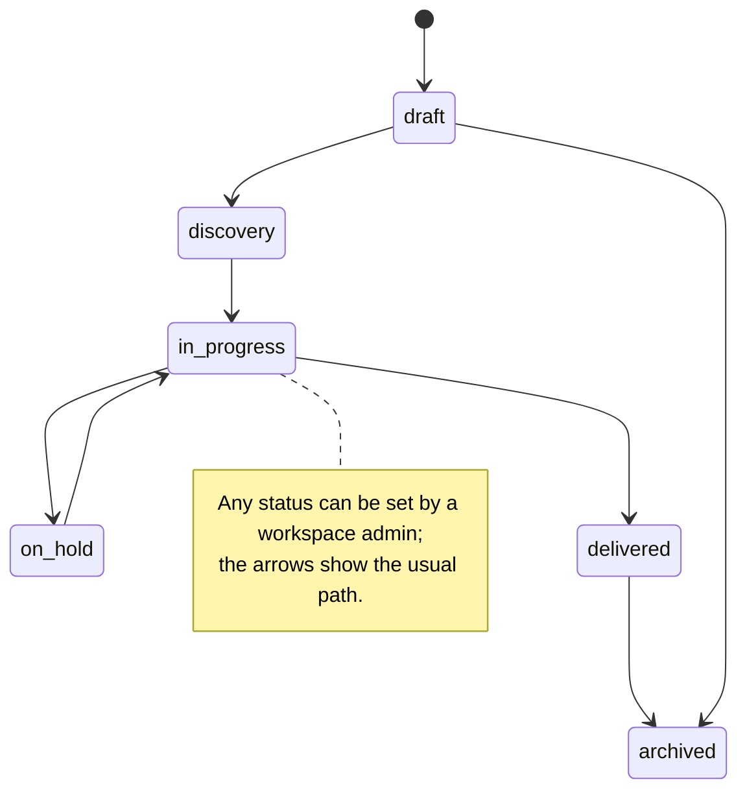
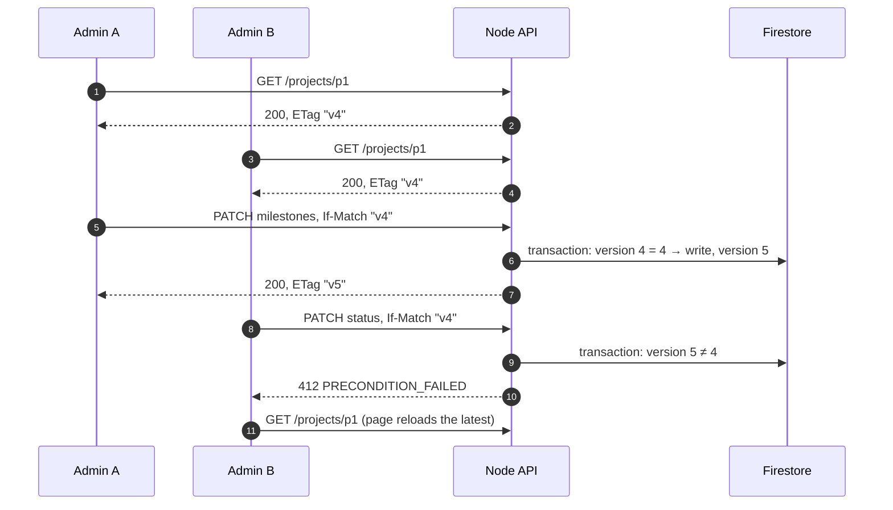
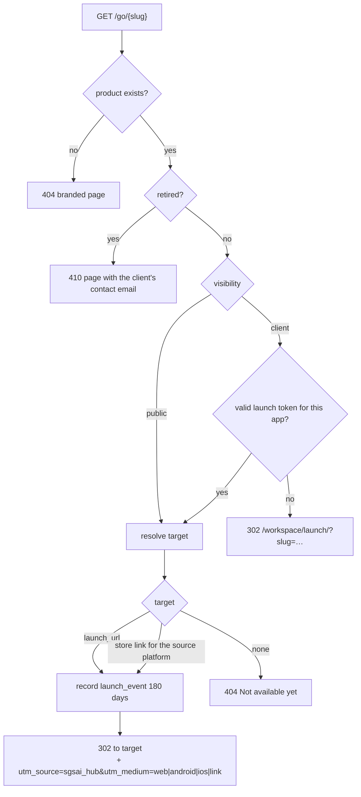
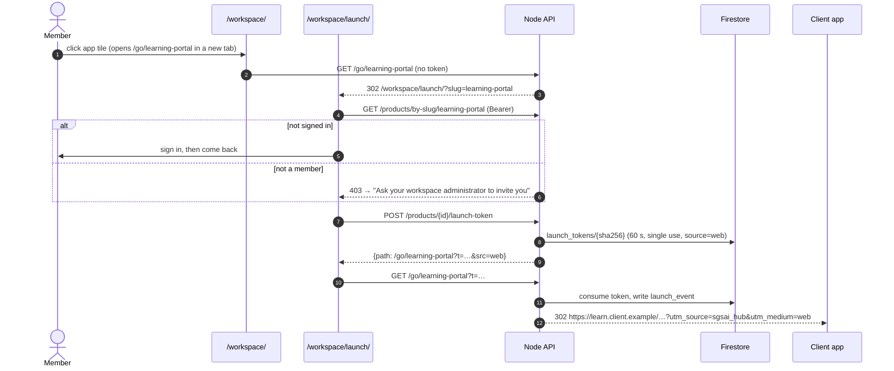
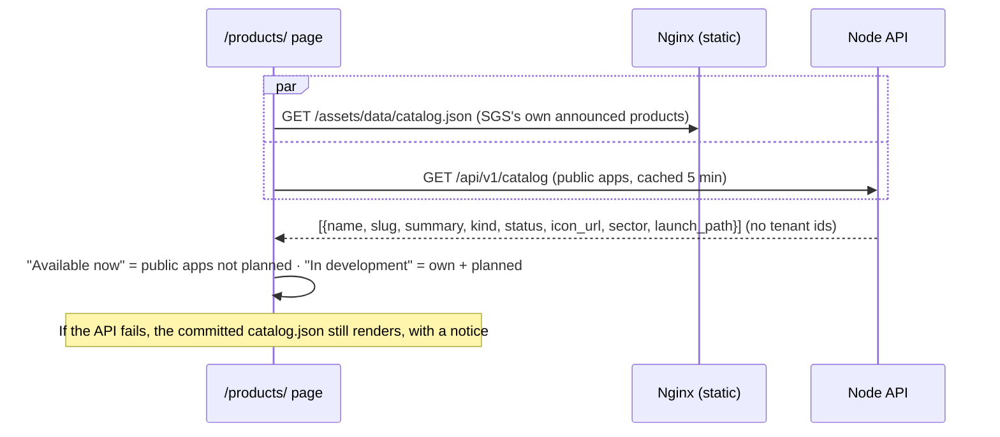

# 5. Projects, products and launch links

Code: [routes/projects.mjs](../../src/server/routes/projects.mjs), [routes/products.mjs](../../src/server/routes/products.mjs), [validation.mjs](../../src/server/validation.mjs). Pages: `/workspace/`, `/workspace/project/?id=`, `/projects/`, `/workspace/launch/`, `/products/`.

## Projects

A project is one business engagement or education programme for a client. It carries the sector-specific details that make the hub useful for both kinds of work.

| Field | Business | Education |
| --- | --- | --- |
| `sector_profile` | `engagement_type` (advisory, build, managed service), `department` | `institution_type` (school, college, university, training), `programme`, `cohort`, `academic_year` |
| Milestone template (`use_template: true`) | Discovery, Proposal, Build, User acceptance testing, Handover | Needs analysis, Pilot cohort, Rollout, Term review |

Shared fields: name, summary, status, tags (≤ 20), start/end dates (end ≥ start), up to 20 milestones `{title, due, done}`, cover image, owner.

### Status lifecycle

Deleting is a **soft delete**: `deleted_at` is set, the project disappears for members, and admins can restore it for 30 days (`POST /projects/{id}/restore`). After that the Firestore TTL policy removes it.

### Concurrent edits (ETag / If-Match)

Two admins ticking milestones at the same time must not overwrite each other.

## Products (apps and services)

| Field | Values / rule |
| --- | --- |
| `kind` | `pwa`, `web`, `service` (need `launch_url`), `android`, `ios` (need a store link or a launch URL) |
| `status` | `planned` (hidden from the launcher), `beta`, `live`, `retired` (link shows a "retired" page) |
| `visibility` | `client` (members only) or `public` (listed on `/products/`; SGS admins only) |
| `slug` | Globally unique, used in `/go/{slug}`; a clash returns `409 SLUG_TAKEN` with a suggestion |
| URLs | `https://` only, no credentials, ≤ 500 characters |
| `project_id` | Optional; must be a project of the same workspace |

## Launch links: `/go/{slug}`

One stable link per app, usable from the workspace, the mobile app, emails and QR codes.

### Opening a client app from the workspace

The mobile app requests the launch token itself (`X-Client-Platform` sets `source` to `android` or `ios`) and opens the returned URL in the browser; see [mobile app](08-mobile-app.md#launching-an-app).

Admins see launch counts per source for the last 30 days in the workspace console (`GET /products/{id}/launches`).

## Public catalog (`/products/`)

Only same-origin paths and `https://` URLs are rendered as links or images on this page.
