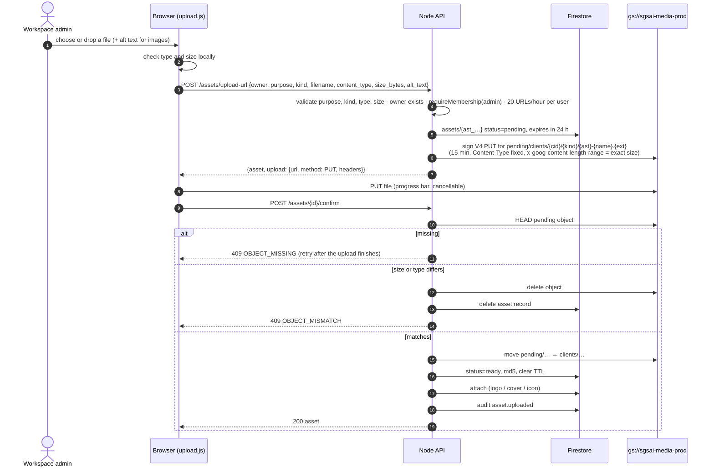
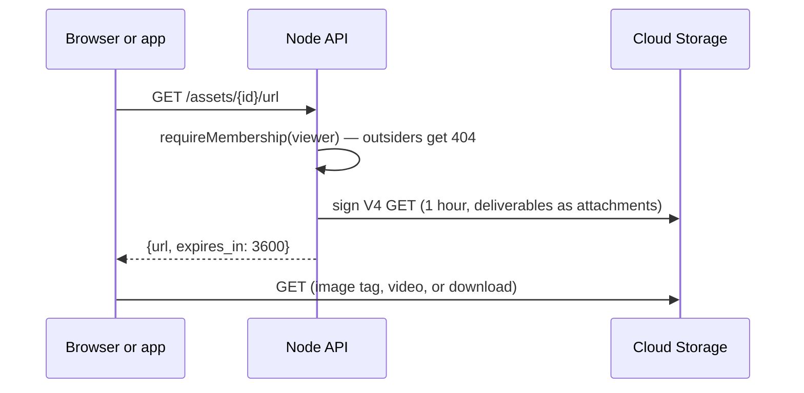
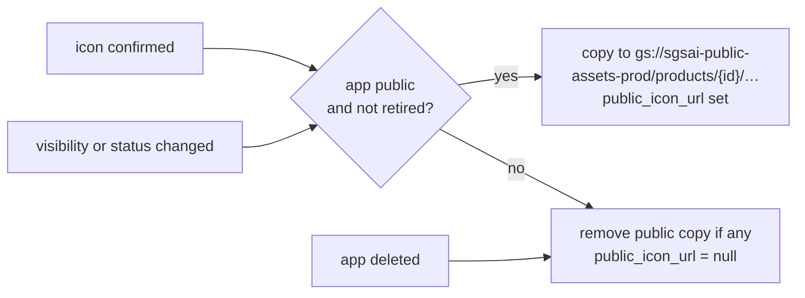

# 6. Media storage

Code: [routes/assets.mjs](../../src/server/routes/assets.mjs), [storage.mjs](../../src/server/storage.mjs), [upload.js](../../public/assets/js/upload.js). Infrastructure: `infrastructure/modules/media-storage`.

## Principles

1. **Bytes never pass through Cloud Run.** The API signs a URL; the browser or app talks to Cloud Storage directly. This keeps the 256 MiB container small and avoids request-size and timeout limits for 500 MB videos.
2. **Firestore holds the record, the bucket holds the file.** An `assets` document stores owner, purpose, kind, size, type, bucket and object name, and status.
3. **Access is checked on every read.** Files are private; a viewer of the workspace gets a signed read URL valid for one hour.
4. **No key files.** The runtime service account signs URLs through IAM `signBlob` (`roles/iam.serviceAccountTokenCreator` on itself).

## What can be uploaded

| Purpose | Attaches to | Kinds | Notes |
| --- | --- | --- | --- |
| `logo` | client | image | Alt text required; sets `branding.logo_asset_id` |
| `cover` | project | image | Alt text required; sets `cover_asset_id`, bumps the project version |
| `icon` | product | image | Alt text required; copied to the public bucket if the app is public |
| `deliverable` | project | image, video, document | Downloads as an attachment |
| `media` | client, project or product | image, video | General media |

| Kind | Max size | Types |
| --- | --- | --- |
| image | 10 MB | PNG, JPEG, WebP, GIF (no SVG: it can carry script) |
| video | 500 MB | MP4, WebM, MOV |
| document | 25 MB | PDF, TXT, CSV, DOCX, XLSX, PPTX (no HTML) |

## Upload sequence

If the user closes the tab before confirming, nothing is left behind: the bucket lifecycle deletes `pending/` objects after 1 day and Firestore's TTL removes the pending record after 24 hours.

## Reading a file

The browser caches signed URLs until one minute before expiry (`hub.js`). The CSP allows `storage.googleapis.com` for `img-src`, `media-src` and `connect-src` only.

## Public icons

Only icons of public apps are ever copied; client files never enter the public bucket. Note: the bucket only serves anonymously when `public_read` is enabled in Terraform ([decision D24](02-decisions.md#d24-public-read-on-the-icon-bucket-is-opt-in)).

## Deleting

`DELETE /assets/{id}` (admin) first clears references (logo, cover, icon; the project version is bumped for covers), then deletes the object and the record, then writes the audit entry. Clearing references first means a failure never leaves a workspace pointing at a missing file.

## Bucket configuration (Terraform)

| Setting | Media bucket | Public assets bucket |
| --- | --- | --- |
| Access | Uniform, public access prevention enforced | Uniform; `allUsers` read only if `public_read = true` |
| Versioning | On; noncurrent versions kept 30 days; soft delete 7 days | Off |
| Lifecycle | `pending/` deleted after 1 day; video to Nearline after 90 days | — |
| CORS | `GET, HEAD, PUT` from the site origins; headers `Content-Type`, `x-goog-content-length-range`, `x-goog-hash` | `GET, HEAD` from anywhere |
| Runtime service account | `roles/storage.objectAdmin` | `roles/storage.objectAdmin` |

Object names never contain raw user input: the base name is slugified and the extension comes from the validated content type.
