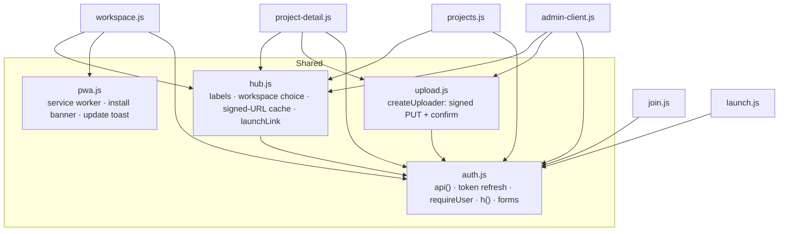
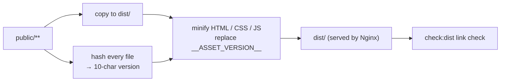
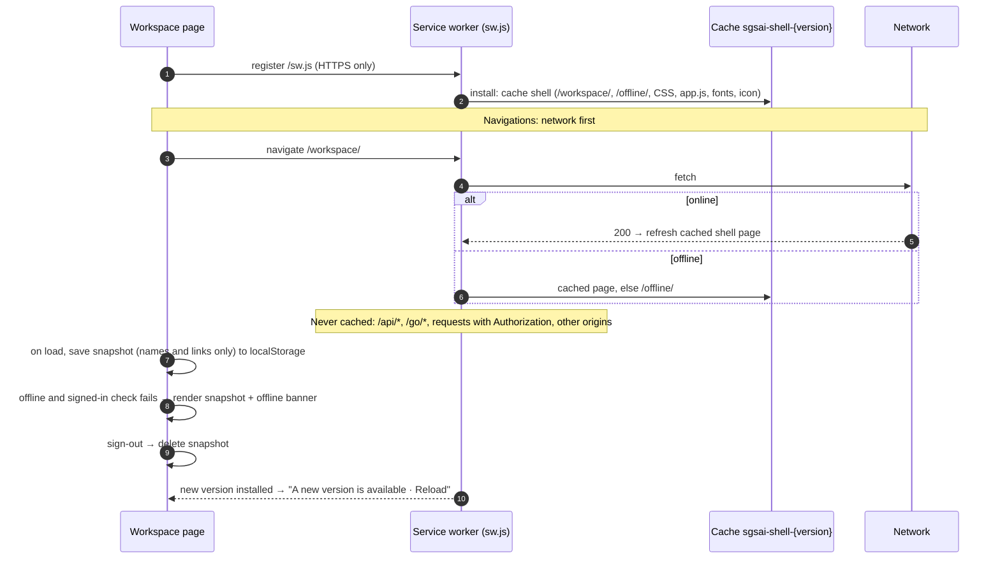

# 7. Web app and PWA

The website and the client hub are one multi-page site in `public/`: plain HTML, CSS and ES modules, no framework and no bundler ([decision D11](02-decisions.md#d11-no-framework-no-bundler)).

## Page map

| Area | Routes | Script |
| --- | --- | --- |
| Marketing (indexed) | `/`, `/vision/`, `/services/`, `/products/`, `/roadmap/`, `/about/`, `/contact/`, `/privacy/`, `/terms/` | `app.js` (fragments, analytics), `script.js`, `products.js`, section scripts |
| Account | `/login/`, `/signup/`, `/verify-email/`, `/forgot-password/`, `/reset-password/`, `/account/` | `login.js`, `signup.js`, …, `account.js` on `auth.js` |
| Client hub | `/workspace/`, `/workspace/project/`, `/workspace/join/`, `/workspace/launch/`, `/projects/` | `workspace.js`, `project-detail.js`, `join.js`, `launch.js`, `projects.js` on `hub.js` |
| Admin | `/admin/` (SGS), `/admin/clients/?id=` (workspace) | `admin-users.js`, `admin-clients.js`, `admin-client.js` |
| PWA | `/offline/`, `/sw.js`, `/site.webmanifest` | `pwa.js` |

Signed-in and account pages carry `noindex` and are disallowed in `robots.txt`; indexed pages must be in `sitemap.xml`, both `ANALYTICS_PATHS` lists and `lighthouserc.json` (a test enforces this).

## Browser module structure



`api()` prefixes `/api/v1`, adds the bearer token, and on a `401` refreshes once (the refresh cookie is sent automatically to `/api/v1/auth`) before retrying. DOM is built with `h()` and `textContent`, never `innerHTML` with data.

## Build and cache busting



- Every page references local CSS/JS as `…?v=__ASSET_VERSION__`; `app.js` loads header, navigation, footer and sections with the same version. Any change to any public file changes the version, so returning visitors never mix old and new files.
- HTML is cached for 5 minutes; CSS/JS revalidate on every load (ETag); fonts and images are cached for a year. `sw.js` always revalidates.

## Content Security Policy

```text
default-src 'self';
script-src 'self' https://accounts.google.com/gsi/client https://appleid.cdn-apple.com;
style-src 'self' https://accounts.google.com/gsi/style;
font-src 'self';
img-src 'self' data: blob: https://*.googleusercontent.com https://storage.googleapis.com;
media-src 'self' https://storage.googleapis.com;
connect-src 'self' https://accounts.google.com/gsi/ https://appleid.apple.com https://storage.googleapis.com;
frame-src https://accounts.google.com/gsi/ https://appleid.apple.com;
worker-src 'self'; manifest-src 'self'; object-src 'none'; base-uri 'self';
frame-ancestors 'none'; form-action 'self' mailto:
```

`npm run lint` reads this policy from `config/nginx.conf` and fails on anything it would block (inline styles or handlers, `<style>` blocks, inline scripts, third-party URLs), because the static preview and Lighthouse run without Nginx and would not show the violation. Fonts (DM Sans, Manrope) are self-hosted; icons are inline SVG.

Headers are set once at server level. A test forbids `add_header` inside an Nginx `location`, because that silently drops every server-level header for that location (bug #76: sub-pages had no CSP and `/login/` could be framed).

## Installable hub and offline use



The manifest starts at `/workspace/?source=pwa` in standalone mode with shortcuts to the workspace and the account page. Static assets use stale-while-revalidate.

## Forms on the marketing site

| Form | Endpoint | Notes |
| --- | --- | --- |
| Contact (home and `/contact/`) | `POST /api/contact` | Consent required; honeypot `website` field; subject and phone travel inside the message (≤ 4,500 characters typed) |
| Stay updated (footer, `/services/`) | `POST /api/contact` (`source: product-updates`) | Consent required |
| Product updates (`/products/`) | `POST /api/contact` | Built per product card |

All were broken before #78 (missing consent, handlers never loaded, inline handlers blocked by the CSP); see bug #77.
