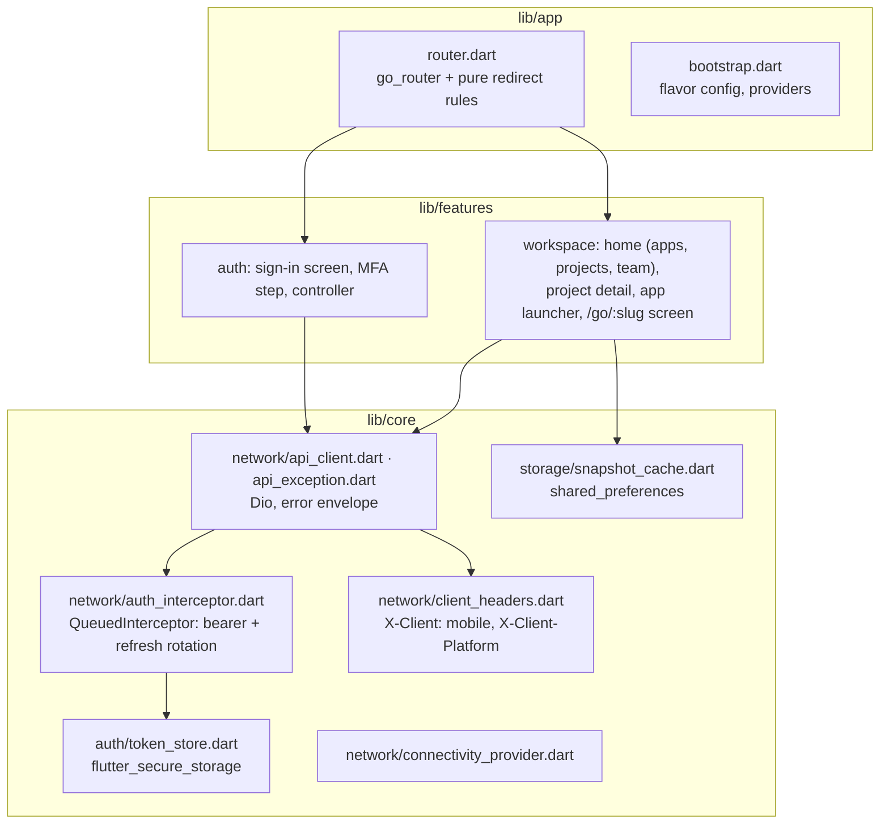
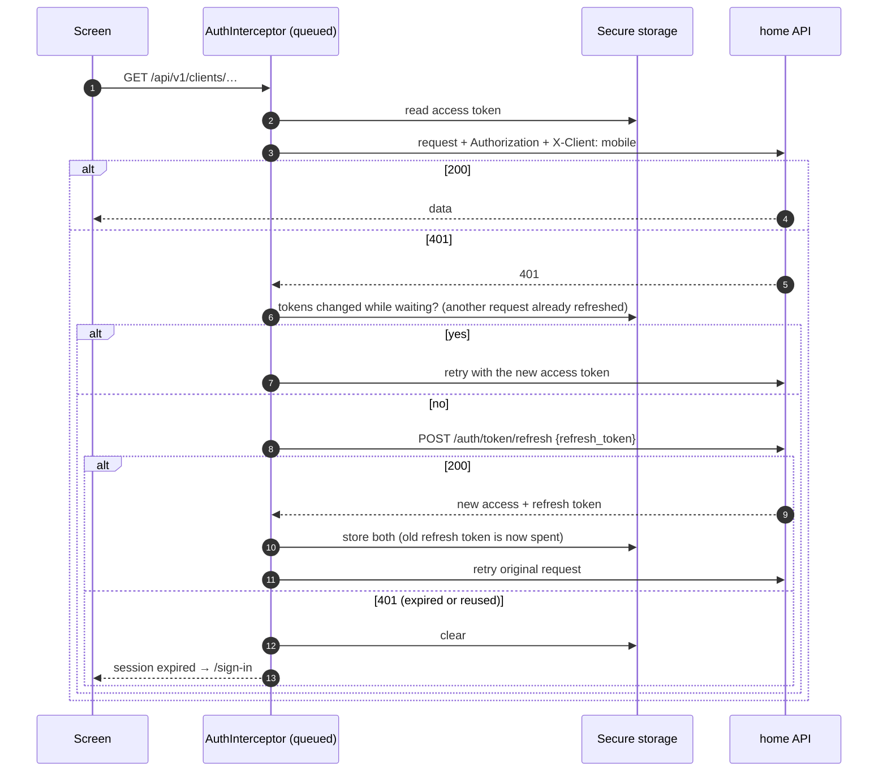
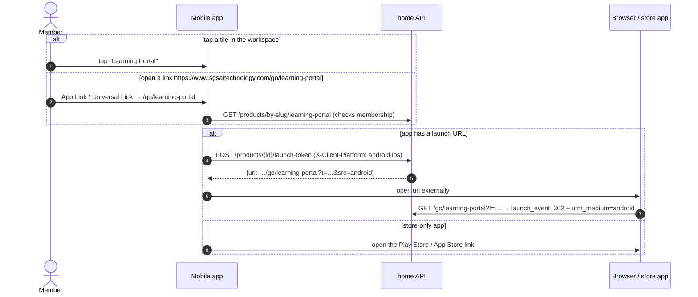

# 8. Mobile app

Repository: `sgsai-lab/mobile-app` (Flutter, Android and iOS), branch `features/client-hub-launcher`, sgsai-lab/mobile-app#29 (open). Product brief and setup live in that repository; this page explains how the app fits the platform.

## Purpose

One app for client staff: sign in with the same SGS account as the website, choose a workspace, open the apps SGS AI built for them, follow projects and see the team. It does not replace the client apps; it launches them ([decision D3](02-decisions.md#d3-one-identity-system-for-web-and-mobile)).

## Structure

| Route | Screen |
| --- | --- |
| `/startup` | Restores tokens, decides where to go |
| `/sign-in?from=` | Email + password, then a 6-digit code if 2FA is on |
| `/` | Workspace home: switcher, apps, projects, team |
| `/project/:projectId` | Milestones, linked apps, team |
| `/go/:slug` | Launch from a deep link |

Flavors: `dev`, `stg`, `prod` with custom schemes `sgsai-dev://`, `sgsai-stg://`, `sgsai://` and App Links / Universal Links on `www.sgsaitechnology.com/go/*`.

## Tokens on the device

Because the interceptor is queued, ten parallel 401s produce one refresh. Sending a spent refresh token twice would revoke the whole session family on the server ([D14](02-decisions.md#d14-session-families-and-refresh-token-rotation)).

## Launching an app

A link opened while signed out goes to `/sign-in?from=/go/…` and continues after sign-in.

## Offline

The last successful workspace view is saved with `shared_preferences` (names, statuses and links only; no tokens, no signed URLs). Without a connection the app shows that snapshot with a banner; signing out clears it.

## Status

| Item | State |
| --- | --- |
| Sign-in on SGS tokens, MFA step, workspace, projects, team, launch, deep links, offline | Done in #29 (`make check`: format, analyze, OpenAPI check, 46 tests; Android debug build passes in CI) |
| CI | Fixed in #29: the workflow file was invalid since before this work, so no checks had ever run |
| Google and Apple sign-in buttons (#7) | Waiting for OAuth client ids and Apple signing |
| Verification on real devices (#24) | Needs Android and iOS devices |
| Push notifications (#27) | Not started |
| App Links / Universal Links | Need `ANDROID_CERT_SHA256` and `APPLE_TEAM_ID` on the website (association files return 404 until then) |
