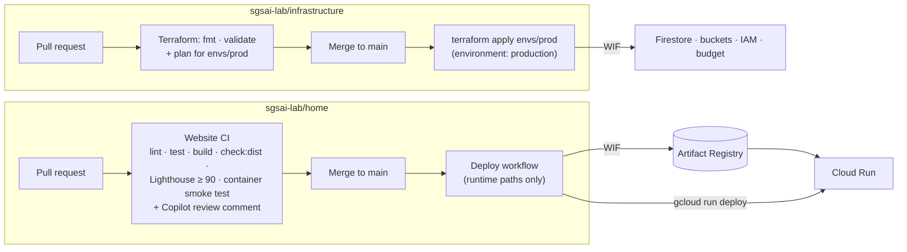
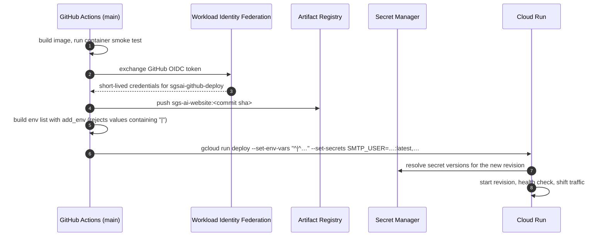
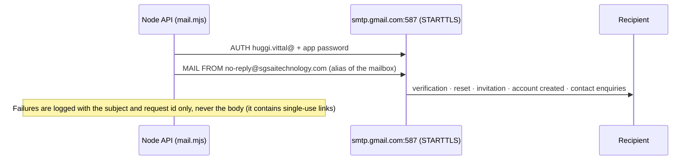

# 9. Infrastructure and delivery

## Google Cloud resources

| Resource | Name / setting | Managed by |
| --- | --- | --- |
| Project, region | `home-509818`, `asia-south1` | — |
| Load balancer | Global external Application Load Balancer `sgsai-https-forwarding-rule` (34.117.157.228), managed certificates for the apex and `www`, HTTP → HTTPS redirect, serverless NEG | `home/infra/gcp/terraform` |
| Cloud Run service | `sgs-ai-website`, min 0 / max 5 instances, 256 MiB, port 8080, ingress all | Created by `home/infra/gcp/terraform`; revisions by the deploy workflow |
| Runtime service account | `sgs-ai-website-runtime@home-509818.iam.gserviceaccount.com` | `home/infra/gcp/terraform` |
| Deploy service account | `sgsai-github-deploy@…` via Workload Identity pool `github-actions` | `home/infra/gcp/terraform`; the infrastructure repo has its own apply identity (`infrastructure/bootstrap`) |
| Artifact Registry | `sgsai-images` (`asia-south1-docker.pkg.dev/home-509818/sgsai-images/sgs-ai-website:<sha>`) | `home/infra/gcp/terraform` |
| Firestore | `(default)`, Native, point-in-time recovery, daily backup kept 14 days, TTL on `expire_at`, composite indexes, deny-all client rules | `infrastructure/modules/firestore` |
| Cloud Storage | `sgsai-media-prod`, `sgsai-public-assets-prod` (see [media storage](06-media-storage.md#bucket-configuration-terraform)) | `infrastructure/modules/media-storage` |
| Secret Manager | `sgsai-smtp-user`, `sgsai-smtp-pass` (`home/infra/gcp/terraform`); `sgsai-mfa-encryption-key`, `sgsai-apple-state-secret` (created with `gcloud` on 2026-10-27) | Runtime SA has `secretAccessor` on each |
| Billing budget | Firestore + Cloud Storage spend; alerts at 50 % and 90 % | `infrastructure/envs/prod` |

### Runtime service account permissions

| Role | On | Used for |
| --- | --- | --- |
| `roles/datastore.user` | project | Firestore reads and writes (`home/infra/gcp/terraform`) |
| `roles/storage.objectAdmin` | both buckets | Head, move, delete, copy objects |
| `roles/iam.serviceAccountTokenCreator` | itself | Signing V4 URLs through `signBlob` (no key files) |
| `roles/secretmanager.secretAccessor` | the four secrets | Secrets mounted as environment variables |

## Delivery pipelines



### Website deployment



The deploy runs only when files that ship change (site, server, Nginx, Dockerfile, package files); documentation, tests and tooling changes do not redeploy.

## Configuration

GitHub repository variables on `sgsai-lab/home` (non-empty values are passed to Cloud Run):

| Variable | Value (prod) | Purpose |
| --- | --- | --- |
| `GCP_PROJECT_ID`, `GCP_REGION`, `GCP_ARTIFACT_REPOSITORY` | `home-509818`, `asia-south1`, `sgsai-images` | Deployment target |
| `GCP_WIF_PROVIDER`, `GCP_WIF_SERVICE_ACCOUNT`, `GCP_RUNTIME_SERVICE_ACCOUNT` | WIF pool, deploy SA, runtime SA | Keyless deployment |
| `SITE_ORIGIN` | `https://sgsaitechnology.com` | Links in emails and launch URLs |
| `ADMIN_EMAILS` | `huggi.vittal@sgsaitechnology.com` | First SGS admin |
| `GOOGLE_CLIENT_ID` / `GOOGLE_CLIENT_IDS` | Web OAuth client id | Google sign-in audiences |
| `APPLE_CLIENT_ID(S)`, `APPLE_ANDROID_PACKAGES`, `APPLE_TEAM_ID` | not set | Apple sign-in, iOS Universal Links |
| `ANDROID_CERT_SHA256` | not set | Android App Links |
| `MEDIA_BUCKET`, `PUBLIC_ASSETS_BUCKET` | `sgsai-media-prod`, `sgsai-public-assets-prod` | File storage |
| `SMTP_HOST`, `CONTACT_FROM` | `smtp.gmail.com`, `no-reply@sgsaitechnology.com` | Email |
| `SMTP_USER_SECRET`, `SMTP_PASS_SECRET` | `sgsai-smtp-user`, `sgsai-smtp-pass` | Secret **names** |
| `MFA_ENCRYPTION_KEY_SECRET`, `APPLE_STATE_SECRET_SECRET` | `sgsai-mfa-encryption-key`, `sgsai-apple-state-secret` | Secret **names** |

Set by the workflow: `SMTP_PORT=587`, `SMTP_SECURE=false`, `CONTACT_TO=hello@sgsaitechnology.com`. Set in the image: `ALLOW_MEMORY_DB_FALLBACK=false`, `API_UPSTREAM=http://127.0.0.1:3000`. Features whose configuration is missing answer `503` (storage, MFA, providers) or `404` (app-link files) instead of failing silently.

Outside Google Cloud, the Google OAuth web client must list both `https://sgsaitechnology.com` and `https://www.sgsaitechnology.com` as Authorized JavaScript origins ([incident 2](10-operations.md#incident-2-google-sign-in-blocked-with-origin_mismatch)).

### Secrets

| Secret | Contents | Rotation |
| --- | --- | --- |
| `sgsai-smtp-user` | `huggi.vittal@sgsaitechnology.com` | When the mailbox changes |
| `sgsai-smtp-pass` | Google Workspace app password (16 characters, version 2; version 1 disabled) | Revoke at myaccount.google.com/apppasswords, add a version, redeploy |
| `sgsai-mfa-encryption-key` | Random 32-byte base64 key (AES-256-GCM) | **Do not rotate casually:** existing 2FA enrolments can no longer be decrypted |
| `sgsai-apple-state-secret` | Random 32-byte base64 HMAC key | Any time; only in-flight Android Apple sign-ins fail |

Add a version without echoing the value:

```sh
read -rs "P?Secret value: " && echo && printf '%s' "$P" | gcloud secrets versions add <secret> --project home-509818 --data-file=- && unset P
```

## Email



`no-reply@` is a Google Workspace alias of `huggi.vittal@`, and is added in Gmail under *Send mail as*. Contact enquiries go to `hello@sgsaitechnology.com` with the visitor as Reply-To.

## Rollout order (as done on 2026-10-27)

1. `infrastructure#15` merged and applied: Firestore indexes, TTLs, rules, backups, buckets, IAM.
2. Repository variables and secrets set; SMTP verified with a test message.
3. `home#78` merged and deployed.
4. Google OAuth origins updated (incident 2).
5. `home#80` merged: legacy account status fix (incident 1).
