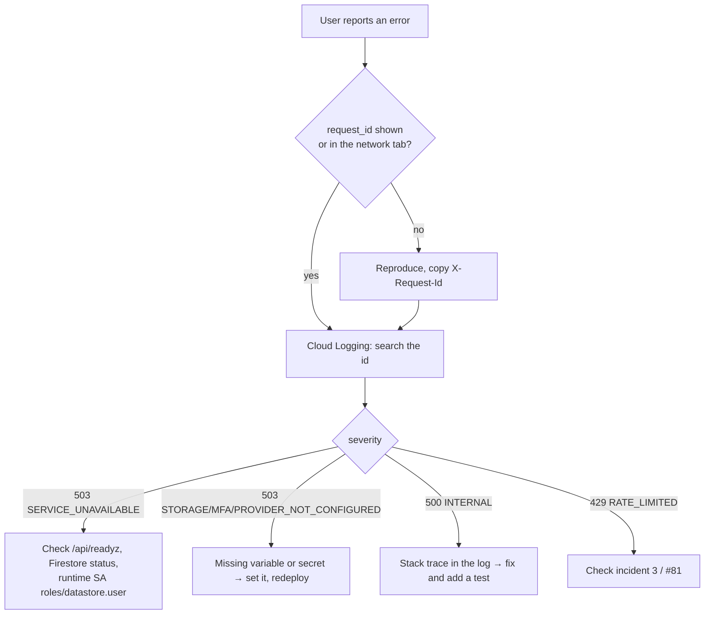
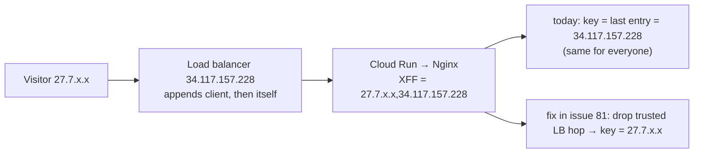

# 10. Operations and incidents

Day-to-day operations of Firestore and Cloud Storage (restore, TTL, CORS, common symptoms) are in the [runbook](../runbook-firestore-gcs.md). This page adds health checks, the incidents seen at launch, and the open items.

## Health checks

| Check | Expect |
| --- | --- |
| `curl -s https://www.sgsaitechnology.com/api/readyz` | `{"status":"ok","database":"firestore"}`; `503` if Firestore is unreachable |
| `curl -sI https://www.sgsaitechnology.com/about/` | `content-security-policy`, `x-frame-options: DENY`, `x-content-type-options: nosniff` |
| `curl -s https://www.sgsaitechnology.com/api/config` | Google client id present |
| `curl -s https://www.sgsaitechnology.com/api/v1/catalog` | `{"items":[…]}` |
| Cloud Run → Logs, filter `severity>=WARNING` | Each failed request logs `request_id`, method, path, status, duration |

Every API response carries `X-Request-Id`; error bodies carry `request_id`. Search the logs for it to find the server-side cause.

## Incidents

### Incident 1: existing accounts reported as "disabled"

| | |
| --- | --- |
| When | 2026-10-27, right after #78 was deployed |
| Symptom | `huggi.vittal@sgsaitechnology.com` (and 4 other existing users) saw "This account has been disabled" |
| Cause | Accounts created before #78 had no `status` field. New checks required `status === 'active'` |
| Immediate fix | Set `status: "active"` on the 5 user documents through the Firestore REST API (field mask `status` only) |
| Permanent fix | #80: user reads default a missing status to `active`; regression test reproduces the exact error |
| Lesson | When adding a required field, either migrate existing documents or default it on read. Test with a document shaped like production data, not only with freshly created ones |

### Incident 2: Google sign-in blocked with `origin_mismatch`

| | |
| --- | --- |
| Symptom | "Access blocked: Authorisation error · Error 400: origin_mismatch" |
| Cause | The site answers on both `sgsaitechnology.com` and `www.sgsaitechnology.com` (no redirect between them); the OAuth web client listed only one as an Authorized JavaScript origin |
| Fix | Google Auth Platform → Clients → web client → add both origins (and `http://localhost:8080` for local testing) |
| Follow-up | Pick one canonical host and redirect the other (canonical tags and the sitemap already use `www`; `SITE_ORIGIN` uses the apex) |

### Incident 3: rate limits shared by all visitors

| | |
| --- | --- |
| Found | 2026-10-27 while documenting the architecture (Nginx access logs) |
| Evidence | Production requests carry `X-Forwarded-For: <client>,<34.117.157.228>`; the last entry is the load balancer |
| Effect | Nginx limits (contact 10/min, launch 120/min) and API limits keyed by IP (sign-in 10/15 min, MFA, launch) are shared by every visitor per instance |
| Why it was missed | The #78 fix was verified against the container alone (Cloud Run topology), not with the load balancer in front |
| Fix | #81: treat the load balancer address as a trusted hop and take the entry before it, in both Nginx and `clientAddress()` |

## Open items

| Item | Owner | Reference |
| --- | --- | --- |
| Fix the rate-limit key behind the load balancer | home | #81 |
| Public icon bucket is not publicly readable (`public_read = false`); icons of public apps return 403 | infrastructure | [D24](02-decisions.md#d24-public-read-on-the-icon-bucket-is-opt-in), infrastructure#19 |
| Canonical host redirect (apex ↔ `www`) and matching `SITE_ORIGIN` | home | Incident 2 |
| Merge the mobile launcher | mobile-app | sgsai-lab/mobile-app#29 |
| Google/Apple sign-in in the app (OAuth ids, Apple signing) | mobile-app | mobile-app#7 |
| App Links / Universal Links: set `ANDROID_CERT_SHA256`, `APPLE_TEAM_ID` | home config | [mobile app](08-mobile-app.md#status) |
| Device verification, push notifications | mobile-app | mobile-app#24, #27 |
| Merge ADR-002 alignment and migration spike | backend-api | sgsai-lab/backend-api#25 |
| Read-only switch for the Postgres cut-over | home | [ADR-003](11-postgres-migration-path.md#cut-over) |
| Sign in with Apple on the web (Services ID, keys) | home config | `APPLE_*` variables |
