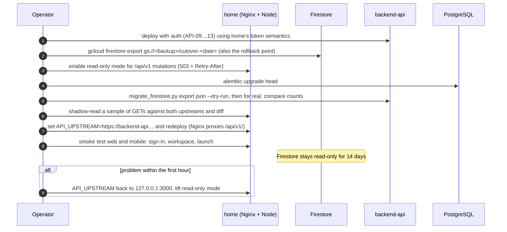

# 11. Postgres migration path

Firestore is the right store today ([D5](02-decisions.md#d5-firestore-native-mode-metadata-only)). This page explains how `/api/v1` can move to PostgreSQL in `backend-api` later without changing any client. The full write-up is ADR-003 in `sgsai-lab/backend-api` (`docs/adr/0003-postgres-migration-plan.md`, PR sgsai-lab/backend-api#25).

## When to move

Revisit when any of these is true: a workspace has more than a few thousand projects or files; reporting needs joins across workspaces; Firestore cost grows faster than usage; or the team needs SQL tooling. Until then the move adds risk without benefit.

## What is already in place

| Piece | Where | Proven by |
| --- | --- | --- |
| Same contract | `backend-api` error envelope and codes now match `home` ([D19](02-decisions.md#d19-one-error-envelope-across-services)) | Unit tests |
| Schema | SQLAlchemy models + Alembic migration `0001_client_hub` for `clients`, `memberships`, `projects`, `products`, `assets`; Firestore ids kept as primary keys | `alembic upgrade → downgrade → upgrade`, `alembic check` (no drift) |
| Mapping | Pure document → row functions; serializers that rebuild `home`'s JSON exactly (timestamps like JavaScript `toISOString()`) | Unit tests against a fixture recorded from `home`'s API |
| Loader | `scripts/migrate_firestore.py export.json [--dry-run]`: one transaction, upsert, idempotent, reports skipped documents | Integration tests on PostgreSQL 16; run twice with identical results |
| Contract replay | Spike read routes (`/clients/{id}`, `/projects/{id}`, `/products`) return byte-identical JSON; mounted only in `local`/`test` | Integration tests, including tenant 404 |

## Cut-over

## Decisions inside the plan

| Choice | Decision | Reason |
| --- | --- | --- |
| Big-bang vs dual-write | Big-bang with a short read-only window | Hundreds of documents; dual-write doubles code paths and failure handling |
| Dual-read | Only as a shadow comparison before the switch | Confidence without serving two truths |
| Users, invites | Move with the auth work | They depend on the token model |
| Sessions, launch tokens | Not migrated | Short-lived; users sign in again |
| Audit log | Exported to storage/BigQuery, not copied | Append-only history, 90-day retention |
| Media | Never moves | Rows keep `gcs_bucket`/`gcs_object`; the bucket stays the store of record |

## Not done yet

- The `home` read-only switch used in step 3.
- `users` and `invites` tables, and the `memberships.user_id` foreign key.
- Converting the LevelDB Firestore export to the loader's JSON (use the Admin SDK reader or export tooling).
