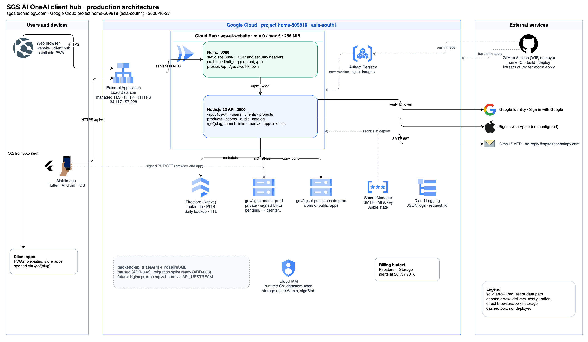

# SGS AI OneAI platform documentation

This folder explains how the SGS AI client hub works end to end: what was built, how the parts talk to each other, and why each decision was made. It covers four repositories in [sgsai-lab](https://github.com/sgsai-lab):

| Repository | Role | State (2026-10-27) |
| --- | --- | --- |
| `home` (this repo) | Website, client hub web app (PWA) and the `/api/v1` API on Firestore | Live (#78, #80) |
| `infrastructure` | Terraform for Firestore, Cloud Storage, IAM and budgets | Applied (#15, #16–#19) |
| `mobile-app` | Flutter launcher for Android and iOS | sgsai-lab/mobile-app#29 open |
| `backend-api` | FastAPI service; paused, holds the Postgres migration path | sgsai-lab/backend-api#25 open |

## Reading order

| # | Document | Read it to understand |
| --- | --- | --- |
| 1 | [Architecture](01-architecture.md) | The system on one page: components, request paths, data storage flow |
| 2 | [Decisions](02-decisions.md) | Every product and technical decision, with the reason and the consequence |
| 3 | [Identity and sessions](03-identity-and-sessions.md) | Sign-up, sign-in, Google/Apple, MFA, tokens, refresh rotation, re-authentication |
| 4 | [Workspaces and access](04-workspaces-and-access.md) | Clients, memberships, roles, invitations, tenant isolation, admins |
| 5 | [Projects, products and launch links](05-projects-products-launch.md) | Business/education projects, apps, `/go/{slug}`, the public catalog |
| 6 | [Media storage](06-media-storage.md) | Signed uploads, confirmation, reads, public icons, bucket layout |
| 7 | [Web app and PWA](07-web-and-pwa.md) | Pages, build, cache busting, CSP, service worker, offline snapshot |
| 8 | [Mobile app](08-mobile-app.md) | Flutter structure, token handling, deep links, offline |
| 9 | [Infrastructure and delivery](09-infrastructure-and-delivery.md) | Terraform, CI/CD, configuration, secrets, email |
| 10 | [Operations and incidents](10-operations.md) | Health checks, runbooks, post-launch incidents, open items |
| 11 | [Postgres migration path](11-postgres-migration-path.md) | How `/api/v1` can move to `backend-api` later |

The architecture diagram's source is [architecture.drawio](architecture.drawio) (official Google Cloud icons). Open it in [diagrams.net](https://app.diagrams.net/) (File → Open from → Device) or with the draw.io VS Code extension, and re-export `architecture.png` after editing. All other diagrams are Mermaid and render on GitHub.

## Related references

These documents explain and connect; they do not repeat field lists. For exact contracts see:

- [API reference](../api.md): every endpoint, status code and limit
- [Data model](../data-model.md): Firestore collections, TTLs, indexes, bucket paths
- [ADR-002](../adr/0002-firestore-first-data-platform.md): the Firestore-first decision
- [Runbook: Firestore and Cloud Storage](../runbook-firestore-gcs.md)
- [Deployment](../deployment.md) and [project plan](../product/oneai-client-platform-plan.md)

## Glossary

| Term | Meaning |
| --- | --- |
| Client / workspace | An organisation SGS AI works with (a business or an education institution). One Firestore `clients` document. |
| Member | A person with a role in a workspace (`viewer < member < admin < owner`). |
| SGS admin | SGS AI staff (`users.role = admin`). Acts as owner in every workspace. |
| Project | A business engagement or education programme for one client, with a sector profile and milestones. |
| Product / app | Something SGS AI delivered for a client (PWA, website, Android/iOS app, service), opened through `/go/{slug}`. |
| Launch token | Single-use, 60-second token that lets a member open a client-only app. |
| Session family | All access and refresh tokens from one sign-in on one device. Revoked as a unit. |
| Asset | Metadata in Firestore for a file stored in Cloud Storage (logo, cover, icon, deliverable, media). |
